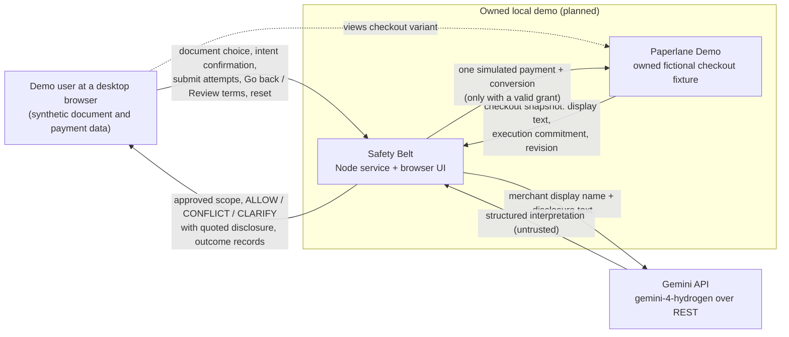
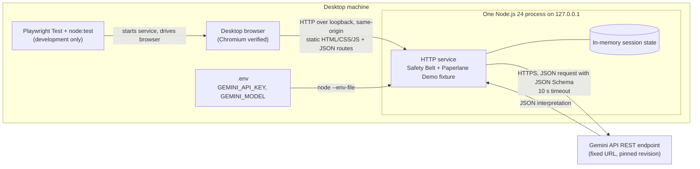

# 3. Context and Scope

<!-- arc42-generated -->
> **Status: planned target architecture.** Nothing in this section exists as running software yet.

**System boundary.** Safety Belt is one local Node.js service and the desktop-browser UI it serves. The service also serves the **Paperlane Demo** checkout fixture. Safety Belt owns this fixture, but the fixture plays the role of the merchant. It supplies the disclosure text and the commitment it would execute, and Safety Belt checks it as if it were a third party. The only external system is the Gemini API. No real merchant, payment processor, bank or document service is part of the context ([README.md](../README.md), [docs/technical-decisions.md](../docs/technical-decisions.md)).
<!-- /arc42-generated -->

## 3.1 Business Context

<!-- arc42-generated -->

| Communication partner | Input to Safety Belt | Output from Safety Belt | Source |
|----------------------|-------|--------|--------|
| **Demo user** (consumer persona, desktop browser) | Selects a synthetic document. Explicitly confirms the intent: one conversion, Paperlane Demo, at most USD 2 (200 cents), one-off billing only. Attempts submission by button, Enter or (in tests) direct JSON. Chooses "Go back" or "Review subscription terms". Resets the session. | The approved scope, shown throughout. Pending, allowed, conflict or clarification states, each with a factual reason, the merchant and the quoted disclosure. A read-only subscription review. A success screen built only from the service's completion state. Inspectable outcome counters. | [#2](https://github.com/shinhf/safety-belt/issues/2), [#6](https://github.com/shinhf/safety-belt/issues/6) |
| **Paperlane Demo** (owned fixture acting as merchant) | Checkout snapshots: checkout ID, a revision that only increases, merchant ID and display name, document and action, the exact public disclosure text, and the separate immutable commitment (upfront cents and currency, billing kind, renewal cents and interval, trial duration). Variants: USD 1 one-off; USD 1 today then USD 49.95 monthly after seven days; USD 3 one-off; non-USD; changed merchant; missing or contradictory terms. | A simulated state change, made only by the gated handler: one payment record and a completed conversion. Never a subscription. | [#1](https://github.com/shinhf/safety-belt/issues/1), [#5](https://github.com/shinhf/safety-belt/issues/5) |
| **Gemini API** (Google, external) | A structured interpretation: upfront cents and currency, merchant, billing kind (`one_off`, `recurring`, `unknown`), renewal cents and interval, trial duration, evidence status (`clear`, `missing`, `contradictory`, `uncertain`, `unsupported`) and supporting quotations. Safety Belt treats it as untrusted input and validates it locally. | A fixed instruction and JSON Schema, plus the public merchant display name and the exact snapshot disclosure text. Nothing else. | [#3](https://github.com/shinhf/safety-belt/issues/3), [docs/technical-decisions.md](../docs/technical-decisions.md) |

**What crosses the model boundary (Proposed, checked by [#7](https://github.com/shinhf/safety-belt/issues/7)):**

| Sent to Gemini | Never sent to Gemini |
|---|---|
| Merchant display name, the exact disclosure text of the current snapshot, fixed extraction instructions, the response schema | User intent, hidden execution-commitment fields, expected evaluation labels, document contents, card, payment or personal data, the API key in any payload field |
<!-- /arc42-generated -->

## 3.2 Technical Context

<!-- arc42-generated -->

| Interface | Channel / protocol | Format | Notes | Source |
|-----------|----------|--------|-------|--------|
| Browser to service | HTTP on `127.0.0.1`, same origin | Allowlisted static HTML, CSS and JS; fixed JSON routes | `Host` and `Origin` are restricted and cross-origin mutations are rejected. There is no permissive CORS. JSON bodies are validated and size-limited. `.env` files are never served. Route names are not yet defined; see [05-building-block-view.md](05-building-block-view.md). | [#1](https://github.com/shinhf/safety-belt/issues/1) |
| Submission paths | Native form submission (button and Enter); direct JSON request | JSON | All three reach the same service handler. A disabled button alone is not enforcement. | [#5](https://github.com/shinhf/safety-belt/issues/5) |
| Service to Gemini | HTTPS REST through Node's built-in `fetch` | JSON request with fixed instructions and a JSON Schema response format; JSON response | Model `gemini-4-hydrogen`. The API key comes from the service environment. The request body is bounded, the timeout is 10 s and errors are sanitized. The service keeps intent and checkout revision tags for each request and compares them when the response returns. Still open in #3: `generateContent` (labelled legacy) or the Interactions API, and the exact structured-output field names (*Verified* ambiguity, plugin-plan §8.2–8.3). | [#3](https://github.com/shinhf/safety-belt/issues/3), [.env.example](../.env.example) |
| Configuration | Environment file loaded with `node --env-file=.env` | `KEY=value` | `.env` is excluded by `.gitignore`. A missing key produces an "unavailable" state that cannot allow. | [.env.example](../.env.example), [#3](https://github.com/shinhf/safety-belt/issues/3) |
| Test harness (development only) | Playwright `webServer` start, Chromium automation, `node:test` | n/a | Uses labelled replay fixtures in place of the live model for deterministic gate tests. Needs no deployment and no live key. | [#7](https://github.com/shinhf/safety-belt/issues/7) |
<!-- /arc42-generated -->

## 3.3 Out of Scope

<!-- arc42-generated -->
| Excluded neighbour or capability | Reason | Source |
|---|---|---|
| Real merchant checkouts, browser extension, third-party interception | A claim about third-party protection would need a real integration and evidence. The MVP claim covers only the owned checkout. | [README.md](../README.md), `safety-belt-mlh/AGENTS.md` |
| Payment processors, card forms, banks, live payments, subscription enrollment | All effects are simulated. Subscription enrollment with fresh consent is P1 work. | [docs/mvp-backlog.md](../docs/mvp-backlog.md), [docs/technical-decisions.md](../docs/technical-decisions.md) |
| PDF engine, real documents, uploads | Conversion is a simulated completion state on a synthetic document. | [#1](https://github.com/shinhf/safety-belt/issues/1) |
| Database, accounts, cloud hosting | One in-memory session on loopback. | [README.md](../README.md) |
| OCR, GPU or NPU pipeline, local redaction stack | Belongs to the earlier redaction proposal (`safety-belt-mlh/inbox/option-b-t2-t3-npu-gpu.md`, `safety-belt-mlh/inbox/research-technical.md`). It is background only. | [docs/technical-decisions.md](../docs/technical-decisions.md) |
| Detecting undisclosed future charges, authenticating merchant backends | Page text cannot show these. Only disclosed terms are observable. | `safety-belt-mlh/.agents/skills/safety-belt-scenarios/SKILL.md` |
<!-- /arc42-generated -->
