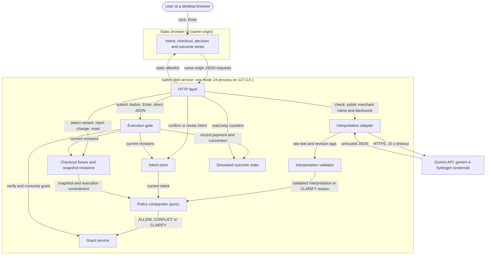
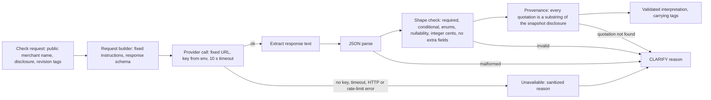
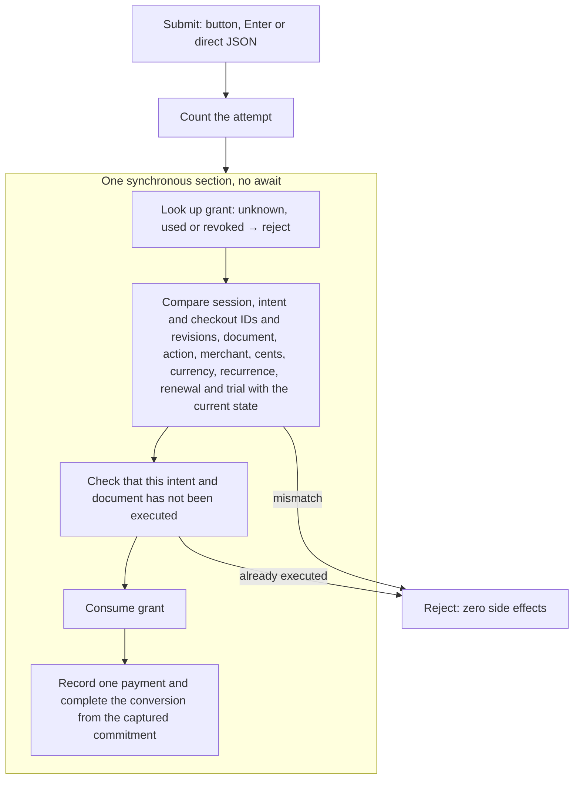

# 5. Building Block View

<!-- arc42: Static decomposition of the system into building blocks and their dependencies. -->

<!-- arc42-generated -->
> **Status:** target architecture. No code exists yet. The module boundaries and file paths below are **proposals** derived from the shared contract in [docs/technical-decisions.md](../docs/technical-decisions.md) and issues #1-#8. Issue #1 fixes the real layout.

## 5.1 Whitebox Overall System (Level 1)

**Motivation:** the system is one local process, so there are no services to split. The decomposition separates the untrusted path (adapter → validator) from the deterministic decision path (policy → grants → gate), and both from the HTTP edge. A reviewer can then confirm that model output reaches execution only through the pure comparator and a server-held grant ([technical-decisions.md:36-39](../docs/technical-decisions.md)). For the external interfaces, see [03-context-and-scope.md](03-context-and-scope.md).

### Contained Building Blocks

| Building block | Responsibility | Interfaces (proposed) | Planned location (proposal) | Issue |
|---|---|---|---|---|
| **HTTP layer** | Binds to `127.0.0.1`. Serves the static-file allowlist and fixed JSON routes. Rejects an unexpected `Host`, a cross-origin `Origin` and a non-JSON content type on mutating routes. Caps the body size itself, because core `http` has none. Sends no permissive CORS. Never serves `.env`. Sanitizes errors. Runs the check flow: read the current state, call the adapter, validator, policy and grants. | `GET` static assets; JSON routes for state, intent, checkout variant and injected change, check, submit, reset. Route names are not fixed by the sources. | `src/server.js` | #1, #5 |
| **Intent store** | Holds the one independently confirmed intent: `intentId`, revision, document, action `convert-one-document`, merchant, `USD`, cap in integer cents (default 200), `one_off_only`. Only explicit confirmation creates or revises it. A revision change invalidates pending checks and grants. | `confirm(fields)`, `current()`, `clear()` | `src/intent.js` | #2 |
| **Checkout fixture and snapshot revisions** | Owns the Paperlane Demo variants and the current immutable snapshot: disclosure text, merchant, document and action, and the execution commitment. Every material change increments the revision, including a change away and back. Hidden evaluation labels stay separate and never leave this block toward the model. | `current()`, `selectVariant(id)`, `injectChange(...)`, `reset()` | `src/fixture.js` | #1 |
| **Interpretation adapter** | Builds the one Gemini REST request from the public merchant display name, the disclosure text and the fixed instructions and schema. Fixed provider URL, key from the environment, 10 s timeout. Tags each call with the intent and checkout revisions. Turns a missing key or any provider failure into an unavailable result. Can be swapped for labelled replay fixtures in tests. | `interpret(snapshotPublicView, tags)` → `{ raw, tags, source: live or replay }` or a failure reason | `src/interpret/gemini.js` | #3 |
| **Interpretation validator** | Hand-written validator, with no schema library. Parses JSON and checks required and conditional fields, enums, nullability, safe nonnegative integer cents and that no extra fields are present. Checks that each quotation is an exact substring of the snapshot disclosure. | `validate(raw, snapshot)` → interpretation or `CLARIFY` reason | `src/interpret/validate.js` | #3 |
| **Policy comparator (pure)** | Deterministic rules over intent, snapshot commitment and validated interpretation. First a semantic cross-check against the execution commitment, then integer-cent cap, currency, merchant, action and document, recurrence and evidence status. Returns `ALLOW`, `CONFLICT` or `CLARIFY` with stable reason codes and revisions. No I/O. | `decide(intent, snapshot, interpretation)` → decision | `src/policy.js` | #4 |
| **Grant service** | Discards a result whose revision tags no longer match the current state. Mints an opaque single-use grant (`node:crypto`) only for `ALLOW`. The grant is bound to session, intent ID and revision, checkout ID and revision and every material commitment field. Revokes grants on any state change or reset. | `issue(decision, state)`, `verifyAndConsume(grantId, state)`, `revokeAll()` | `src/grants.js` | #4 |
| **Execution gate** | The single submit handler for all paths. Counts the attempt. In one synchronous block with no `await` it compares current state with the grant, consumes the grant and records the outcome of the captured commitment. Enforces at most one payment per intent and document. Never creates a subscription. | `submit(grantId)` → executed, or rejected with a reason | `src/gate.js` | #5 |
| **Simulated outcome state** | The source of truth: attempted submissions, executions, payment records, subscription records (always zero in the MVP) and conversion status. Read-only to the UI. | `record(commitment)`, `snapshot()`, `reset()` | `src/outcome.js` | #1, #5 |
| **Static browser UI** | Intent confirmation surface, checkout view, pending, `ALLOW`, `CONFLICT` and `CLARIFY` states with quoted evidence, Go back and read-only Review subscription terms, a success screen driven only by service state, and outcome counters. Labels everything as fictional or simulated, and the interpretation as live or replay. All untrusted strings go in through `textContent`. | Native `<form>` submit (button and Enter) → submit route; JSON fetches | `public/index.html`, `public/app.js`, `public/styles.css` | #1, #2, #6 |

**Test and evaluation assets (proposal, not runtime blocks):** `test/*.test.js` (`node:test`: policy, validator, grants, gate, HTTP API), `test/fixtures/model-replay/*.json` (labelled recorded responses), `e2e/*.spec.js` with `playwright.config.js` (Chromium journey, issue #7) and `eval/` (the labelled live paraphrase set and run records, issue #8).

## 5.2 Level 2

Two blocks carry most of the contract's safety requirements, so they are opened up. The other blocks are simple holders.

### 5.2.1 Interpretation pipeline (adapter and validator, white box)

| Component | Responsibility |
|---|---|
| Request builder | Builds the payload from public fields only. The JSON Schema states the shape, but the schema is not trusted for enforcement, because Gemini drops `minLength`, `maxLength` and `uniqueItems` without warning (`safety-belt-mlh/planning/plugin-plan.md` §8.4). The request field name and API surface are open (see [04-solution-strategy.md](04-solution-strategy.md) §4.3). |
| Provider call | Uses `fetch` with an abort timeout. Never logs the key or the request body. Errors are mapped to sanitized reasons and never fall back to authorization. |
| Parse, shape check and provenance | Explicit validator code (`technical-decisions.md:28`). The output is the interpretation contract in `technical-decisions.md:36`, or a reason that the policy maps to `CLARIFY`. |
| Replay seam | Tests inject labelled recorded responses at the provider-call boundary. Everything downstream of the call runs unchanged. |

### 5.2.2 Execution gate (white box)

| Component | Responsibility |
|---|---|
| Attempt counter | Counts every submit, including rejected ones, separately from executions ([technical-decisions.md:40](../docs/technical-decisions.md)). |
| Synchronous section | Check, consume and record must not yield to the event loop. Concurrent clicks then serialize in the single process without a lock ([technical-decisions.md:39](../docs/technical-decisions.md)). |
| Captured commitment | Executes the commitment stored in the grant at issue time. It never reads mutable fixture state for the terms it executes. |
<!-- /arc42-generated -->

## 5.3 Level 3

<!-- arc42-manual: Add once code exists, if a Level 2 component grows complex enough (for example the validator's per-field rules). Replace the proposed paths in 5.1 with the real layout after issue #1. -->
<!-- /arc42-manual -->
