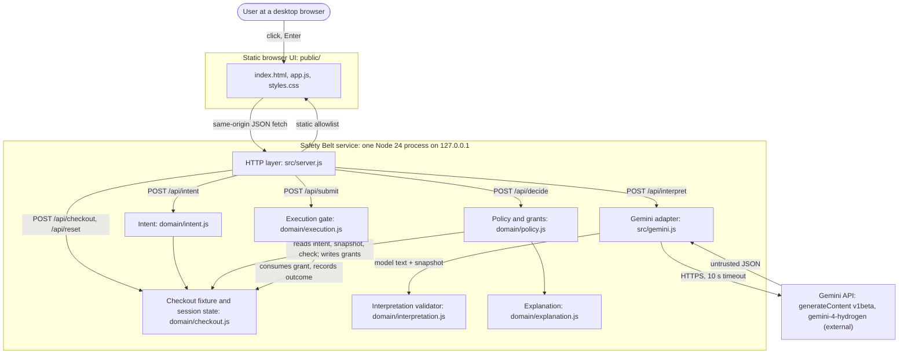
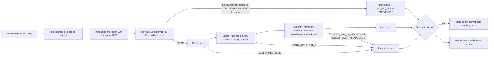
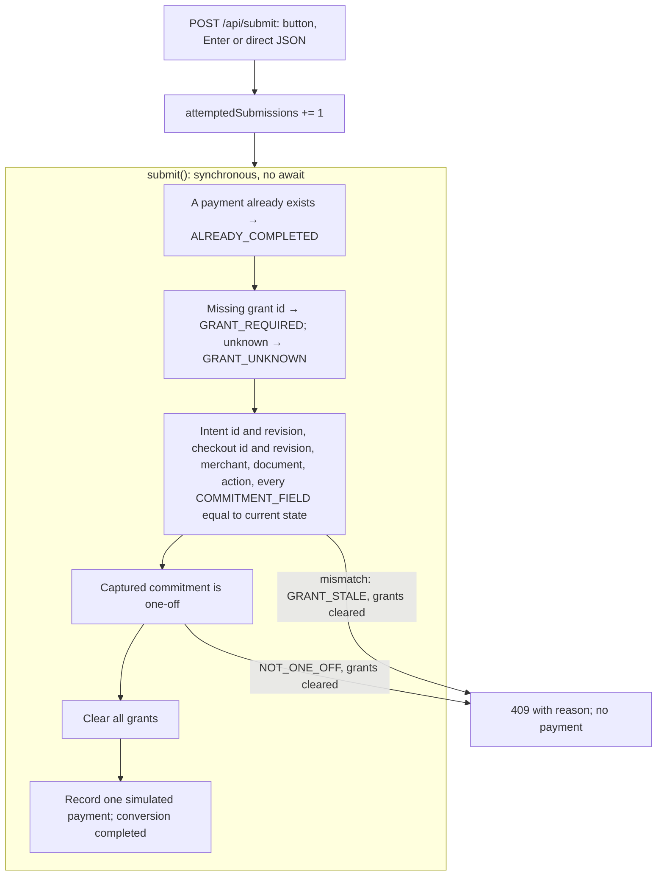

# 5. Building Block View

<!-- arc42: Static decomposition of the system into building blocks and their dependencies. -->

<!-- arc42-generated -->
> **Status:** implemented for tasks 1–7 (on `main`, `9b8199e`). Paths, functions and routes below are read from the code. Task 8 (live evaluation) part A is on `main` (`dbb2e35`); the rest of task 8 is in progress. Nothing here is a measured prevention result.

## 5.1 Whitebox Overall System (Level 1)

**Motivation:** the system is one local process. The decomposition keeps the untrusted path (adapter → validator) apart from the deterministic decision path (policy → gate), and both apart from the HTTP edge. Model output reaches execution only through `decide()` and a server-held grant ([technical-decisions.md](../docs/technical-decisions.md)). Everything under `src/domain/` is pure apart from `node:crypto` IDs and module-level revision counters; I/O lives in `src/server.js` and `src/gemini.js`. External interfaces: [03-context-and-scope.md](03-context-and-scope.md).

### HTTP routes (`src/server.js`)

| Route | Body fields | Does |
|---|---|---|
| `GET /`, `/app.js`, `/styles.css` | — | Fixed static allowlist; URL paths are never joined onto the filesystem |
| `GET /api/variants` | — | Variant ids and labels |
| `GET /api/state` | — | Public snapshot, outcomes, intent, current check, `simulation: true` |
| `POST /api/checkout` | `variantId` | Selects a variant (new snapshot revision, grants revoked) |
| `POST /api/intent` | `documentId`, `merchantId`, `currency`, `capCents`, `billingScope`, `confirmed` | Confirms or revises the intent |
| `POST /api/interpret` | none | One model call for the current tags, shared by concurrent requests; a response that arrives after a change is returned as `stale` and not stored |
| `POST /api/decide` | none | Decides on server-held state only and returns `{ decision, grantId, explanation }` |
| `POST /api/submit` | `grantId` | The single execution gate for button, Enter and direct API |
| `POST /api/reset` | none | New session state |

### Contained Building Blocks

| Building block | Responsibility | Interface | Location | Task |
|---|---|---|---|---|
| **HTTP layer** | Binds `127.0.0.1`. Rejects a `Host` other than `127.0.0.1:<port>` / `localhost:<port>` (421) and a foreign `Origin` on POST (403). Requires `application/json` (415), caps bodies at 4096 bytes (413) and rejects unknown fields (400). Sends `nosniff`, `Content-Security-Policy: default-src 'self'; frame-ancestors 'none'` and `no-store`. Holds the one session, the in-flight call map and the current check. Unexpected errors become `INTERNAL_ERROR`. | `startServer({ port, gemini })` → `{ server, url }`. An injected `gemini` transport is labelled `replay`; the default is `live`. | `src/server.js` | 1, 5 |
| **Checkout fixture and session state** | Seven Paperlane Demo variants (`one-off-usd1`, `trial-recurring`, `one-off-usd3`, `non-usd`, `changed-merchant`, `missing-terms`, `contradictory-terms`). Deep-frozen snapshots with a module-wide revision that never repeats, even across resets. Holds the session: `checkout`, `outcomes`, `intent`, `checks`, `grants`. Hidden labels (`EXPECTED_DECISIONS`) and the `commitment` never leave through `publicSnapshot()`. | `createSession`, `selectVariant`, `publicSnapshot`, `outcomeView`, `reset`, `variantList`, `COMMITMENT_FIELDS` | `src/domain/checkout.js` | 1 |
| **Intent** | Only explicit confirmation (`confirmed: true`) creates or revises the intent. Fixed document, merchant, `USD`, `one_off_only`, cap 0…`MAX_CAP_CENTS` integer cents. Each confirmation increments the revision and clears checks and grants. | `confirmIntent(session, fields)`, `intentView(session)` | `src/domain/intent.js` | 2 |
| **Gemini adapter** | One `generateContent` call on `v1beta` with the merchant display name and disclosure as a JSON data block, fixed system instruction, `responseMimeType` + `responseJsonSchema`, `thinkingLevel: LOW`. 10 s abort timeout, `redirect: 'error'`, 64 KiB response cap, input caps (merchant 100, disclosure 2000 chars). No retries. Every failure is `status: 'unavailable'` with a `NO_API_KEY` / `PROVIDER_*` reason. | `interpretCheckout(snapshot, tags, gemini)` → check `{ tags, source, input, status, reasons, interpretation, provider }` | `src/gemini.js` | 3 |
| **Interpretation validator** | Hand-written. Shape check (exact field set, enums, nullable integer cents, `^[A-Z]{3}$` currency, ≤ 5 quotes of ≤ 500 chars), then semantic check (merchant name, quotes verbatim in the disclosure, one-off/recurring consistency, agreement with the owned commitment). Also exports the `RESPONSE_SCHEMA` sent to Gemini. | `validateInterpretation(raw, snapshot)` → `{ ok, reasons, interpretation }` | `src/domain/interpretation.js` | 3 |
| **Policy and grants** | `decide()` is pure: CLARIFY codes win over CONFLICT codes; `ALLOW` needs zero reasons. `evaluate()` decides on the session's current state (it takes no verdict as input), revokes all earlier grants, and only on `ALLOW` mints a 32-byte `base64url` grant bound to intent id and revision, checkout id and revision, merchant, document, action and a copy of the commitment. | `decide(intent, snapshot, check)`, `evaluate(session, check)` → `{ decision, grantId }` | `src/domain/policy.js` | 4 |
| **Execution gate** | Counts the attempt, then in one synchronous step rejects (`ALREADY_COMPLETED`, `GRANT_REQUIRED`, `GRANT_UNKNOWN`, `GRANT_STALE`, `NOT_ONE_OFF`) or consumes the grant and records one simulated payment from the captured commitment. Never creates a subscription. | `submit(session, grantId)` → `{ ok, payment }` or `{ ok: false, reason }` | `src/domain/execution.js` | 5 |
| **Explanation** | Turns a decision into plain-text lines: tone, headline, what was approved, the disclosed terms (only when validated and not a clarification), reason texts, evidence quotes, live/replay source. Hides conflict reasons during a clarification. Unknown codes map to `GENERIC_REASON`. | `explain(intent, decision, check)`, `reasonText(code)` | `src/domain/explanation.js` | 6 |
| **Static browser UI** | Intent form, checkout with variant selector, one `pay-form` submit handler (button and Enter), decision panel with Go back and a read-only "Review subscription terms" `
`, success panel, outcome counters, live/replay label. Every server and model string is written with `textContent`. | `fetch` to the routes above | `public/index.html`, `public/app.js`, `public/styles.css` | 1, 2, 6 |

**Simulated outcome state** is not a separate module: `session.outcomes` (`attemptedSubmissions`, `executions`, `payments`, `subscriptions`, `conversionStatus`) is created in `checkout.js`, written only by `execution.js` and read through `GET /api/state`.

### Test and evaluation assets (not runtime blocks)

| Asset | Location | State |
|---|---|---|
| Domain unit tests (`node:test`) | `test/domain/*.test.js` | On `main` |
| HTTP integration tests against `startServer({ port: 0 })` with a stubbed transport | `test/integration/*.test.js` | On `main` |
| Labelled replay responses | `test/fixtures/gemini-replay.json` | On `main` |
| Live smoke check | `scripts/smoke-gemini.js` (`npm run smoke:gemini`) | On `main` |
| Playwright + Chromium specs; each test starts its own `startServer()` with a replay stub (no `webServer`) | `e2e/*.spec.js`, `e2e/fixtures.js`, `playwright.config.js`, `scripts/test-all.js` | Task 7, on `main` |
| Live eval runner and scoring | `src/eval.js`, `src/domain/evaluation.js`, `scripts/eval-gemini.js` (`npm run eval:gemini`), `eval/billing-cases.json`, `eval/runs/*.json` | Task 8 part A, on `main` |

## 5.2 Level 2

### 5.2.1 Interpretation pipeline (adapter and validator, white box)

| Component | Responsibility |
|---|---|
| In-flight map | Concurrent `/api/interpret` requests for the same `intentRevision:checkoutId:checkoutRevision` share one provider call. |
| Request builder | `SYSTEM_INSTRUCTION` treats the data block as data and asks for verbatim quotes. `generationConfig()` is the single place that names the structured-output field. Gemini strips some schema keywords, so the schema is not the enforcement. |
| Provider call | `fetch` with `AbortSignal.timeout(10_000)` and `x-goog-api-key`. The key and the request body are never logged. Errors map to sanitized reasons and never to authorization. |
| Validator | `shapeErrors` then `semanticErrors`; `ok: false` always ends in CLARIFY. |
| Freshness | After the call the server compares tags with the current state. A late answer is returned as `stale` and cannot restore a check or a grant. |
| Replay seam | Tests inject `gemini: { apiKey, fetch }` into `startServer`; everything after `fetch` runs unchanged and is labelled `replay`. |

### 5.2.2 Execution gate (white box)

| Component | Responsibility |
|---|---|
| Attempt counter | Counts every submit, rejected ones included, separately from `executions`. |
| Synchronous section | The server calls `submit()` with no `await` between reading the body and responding, so concurrent submits serialize in the single process. |
| Captured commitment | The payment amount and currency come from the grant, not from a re-read of the fixture. |
| One payment per run | Checked first, so a retry after a lost response gets `ALREADY_COMPLETED` and reads the outcome from `/api/state`. |
<!-- /arc42-generated -->

## 5.3 Level 3

<!-- arc42-manual: Add once code exists, if a Level 2 component grows complex enough (for example the validator's per-field rules). Replace the proposed paths in 5.1 with the real layout after issue #1. -->
<!-- /arc42-manual -->
