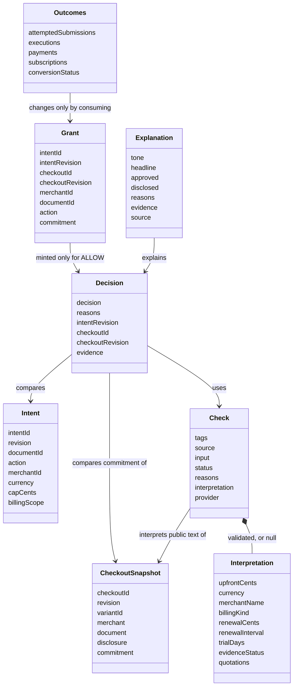
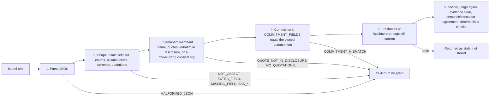

# 8. Crosscutting Concepts

<!-- arc42: Principal regulations and solution ideas relevant in multiple parts of the system. -->

<!-- arc42-generated -->
> **Status:** implemented for tasks 1–7 (`main`, `9b8199e`) and read from the code. Task 8 (live evaluation) part A is on `main` (`dbb2e35`); the rest is in progress. Everything applies only to the owned Paperlane Demo checkout ([docs/technical-decisions.md](../docs/technical-decisions.md)). Test passes use labelled replay answers and are not evidence of model accuracy.

## 8.1 Domain Model

| Entity | As implemented |
|---|---|
| Intent | `src/domain/intent.js`. Action `convert-one-document`, merchant `paperlane-demo`, document `doc-synthetic-001`, `USD`, `capCents` 0…99,999,999, `billingScope: one_off_only`. The UI default cap is 200. Only `confirmIntent` with `confirmed: true` creates or revises it. |
| Checkout snapshot | `src/domain/checkout.js`. Deep-frozen per revision. `commitment` has exactly `COMMITMENT_FIELDS`: `upfrontCents`, `currency`, `billingKind`, `renewalCents`, `renewalInterval`, `trialDays`. `publicSnapshot()` drops `commitment` and `variantId`. Hidden labels (`EXPECTED_DECISIONS`) are separate and never served or sent to the model. |
| Check | `src/gemini.js`. The adapter's result: revision `tags`, `source` (`live` or `replay`), the model `input`, `status` (`interpreted`, `clarify`, `unavailable`; the server adds `stale` for late answers), `reasons`, the validated `interpretation` or `null`, and `provider` metadata (`api`, `model`, `modelVersion`, `responseId`). |
| Interpretation | `src/domain/interpretation.js`. `billingKind`: `one_off`, `recurring`, `unknown`. `renewalInterval`: `day`, `week`, `month`, `year`. `evidenceStatus`: `clear`, `missing`, `contradictory`, `uncertain`, `unsupported`. Cents are nullable non-negative safe integers. At most 5 quotations of up to 500 characters. |
| Decision | `src/domain/policy.js`. `ALLOW`, `CONFLICT` or `CLARIFY`, with every reason that fired (CLARIFY codes first), the revisions and the evidence quotes. |
| Grant | `src/domain/policy.js`. A random 32-byte `base64url` id that maps to the frozen binding above. Server-held in `session.grants`; the browser only ever holds the id. |
| Outcomes | `src/domain/checkout.js`, written only by `submit()`. The source of truth for success. Attempts and executions are counted separately; `subscriptions` stays empty. |
| Explanation | `src/domain/explanation.js`. Plain text for the decision panel; it explains and never decides. |

The glossary for these terms is in [12-glossary.md](12-glossary.md).

## 8.2 Trust boundaries and the untrusted model output pipeline

| Boundary | What crosses it | Trust | Control (as implemented) |
|---|---|---|---|
| Browser → service | Intent fields, `variantId`, `grantId` | Untrusted; direct JSON can bypass the UI | Host check (421), Origin check on POST (403), `application/json` (415), 4096-byte cap (413), per-route field allowlist (400). `/api/decide` and `/api/interpret` accept no body fields, so no verdict, interpretation or grant can be supplied ([technical-decisions.md](../docs/technical-decisions.md), task 4). |
| Fixture disclosure → model | Merchant display name and disclosure text | Treated as untrusted merchant text | Sent as a `<data>` JSON block. The system instruction says it is data, not instructions. The model has no tools. |
| Model → service | Structured JSON text | Untrusted. Gemini drops some schema keywords and does not guarantee correct values. | The pipeline below |
| Service → browser | Snapshot, check, decision, explanation, counters | Contains untrusted strings | `textContent` only and the CSP header (§8.7) |

The steps run in this order. Any failure ends in `CLARIFY` with reasons, or in a discarded answer:

Rules that hold at every step:

- Model output is never turned into HTML, code or a request to another system.
- One-off needs explicit wording and a supporting quotation; absence of recurring words is not evidence. The validator proves each quote is in the disclosure, not that it supports `billingKind` (`shortcut:` comment in `interpretation.js`; task 8 measures this).
- The commitment is cross-checked twice: in the validator (`COMMITMENT_MISMATCH`) and again in `decide()` (`SEMANTIC_EXECUTION_DISAGREEMENT`).
- Only `evaluate()` mints grants, and only for `ALLOW`.

## 8.3 Approval binding and revision invalidation

- **Monotonic revisions.** Intent and checkout revisions come from module-level counters that never repeat, even across `reset`. Every variant switch builds a new snapshot revision, including a switch away and back.
- **Tag on request, compare on response.** `/api/interpret` captures `intentRevision:checkoutId:checkoutRevision` before the call. If the state changed while the call ran, the answer is returned as `stale` and stored nowhere. `decide()` compares the tags again (`INTERPRETATION_STALE`).
- **Only the current check is readable.** A stored check replaces all earlier checks, and storing one also revokes all grants.
- **Revoke on change and check at the gate.** Grants are cleared on intent confirmation, variant selection, a new stored check, every `evaluate()`, every gate rejection after lookup, every execution and reset. The gate still compares every bound field itself.
- **Reset instead of session id.** The MVP has one session and no session id in the grant. Non-repeating revisions give the same effect: a grant from before a reset cannot match the new state.
- **No consent from review.** "Review subscription terms" is a client-side `
` that sends no request. The MVP has no override that authorizes a subscription.

## 8.4 Replay protection and the execution boundary

Following the OWASP Transaction Authorization guidance: each authorization credential is accepted once, bound to the transaction data and checked server-side.

- Button, Enter and direct JSON all reach `POST /api/submit` → `submit()`. The UI has one form `submit` handler.
- `submit()` is synchronous and the route has no `await` between reading the body and responding, so duplicate and concurrent submits serialize in one Node process without a lock.
- The payment uses the commitment captured in the grant, never re-read fixture state.
- At most one payment per run: a second submit gets `ALREADY_COMPLETED` before the grant is even looked up.
- A client that lost the response reads the true outcome from `GET /api/state`.

## 8.5 Error handling: fail closed

| Condition | Result | Side effects |
|---|---|---|
| No intent / invalid intent | `CLARIFY` `INTENT_MISSING` / `INTENT_INVALID` | None |
| `/api/interpret` without an intent | HTTP 409 `INTENT_REQUIRED` | None |
| No API key | check `unavailable` `NO_API_KEY` → `CLARIFY` | None |
| Timeout (10 s), network, HTTP error, blocked, incomplete or oversized response | `unavailable` `PROVIDER_TIMEOUT` / `PROVIDER_NETWORK` / `PROVIDER_HTTP_<status>` / `PROVIDER_BLOCKED` / `PROVIDER_INCOMPLETE` / `PROVIDER_BAD_RESPONSE` → `CLARIFY` | None |
| Disclosure or merchant name over the input cap | `clarify` `INPUT_TOO_LARGE` | None; no provider call |
| Malformed or wrongly shaped model JSON, fabricated quote | `clarify` with validator reasons → `CLARIFY` | None |
| Evidence not `clear`, `billingKind` unknown, unsupported amount | `CLARIFY` | None |
| Interpretation disagrees with the owned commitment | `CLARIFY` (`COMMITMENT_MISMATCH` and/or `SEMANTIC_EXECUTION_DISAGREEMENT`) | None |
| Clear terms, but recurring, over cap, other currency, merchant, document or action | `CONFLICT` with the specific reason | None |
| Stale model response | Returned as `stale`; the user checks again | None |
| Submit without a valid current grant | HTTP 409 with the gate reason | Attempt counter only |
| Unexpected server error | HTTP 500 `INTERNAL_ERROR`; message logged, no stack or provider body in the response | None |

Money is always compared as integer cents: 200 cents is allowed and 201 cents is `OVER_CAP` against a 200-cent cap.
<!-- /arc42-generated -->

### Decision reason codes

Approved by the project owner on 2026-11-13. The policy comparator (issue [#4](https://github.com/shinhf/safety-belt/issues/4)) returns these codes with every `CONFLICT` or `CLARIFY` decision. They are stable identifiers: tests and the UI depend on the names.

| Decision | Code | Fires when |
|---|---|---|
| CONFLICT | `RECURRING_BILLING` | Validated terms show recurring billing; the intent is one-off only (the USD 1 trial that becomes USD 49.95 per month). |
| CONFLICT | `OVER_CAP` | Upfront integer cents exceed the cap (201 > 200). |
| CONFLICT | `CURRENCY_MISMATCH` | Currency is not USD. |
| CONFLICT | `MERCHANT_MISMATCH` | Merchant is not the approved one. |
| CONFLICT | `ACTION_MISMATCH` | Action is not `convert-one-document`. |
| CONFLICT | `DOCUMENT_MISMATCH` | Document is not the selected one. |
| CLARIFY | `INTENT_MISSING` | No valid confirmed intent. |
| CLARIFY | `MODEL_UNAVAILABLE` | Missing key, timeout, HTTP error or rate limit. |
| CLARIFY | `MODEL_OUTPUT_INVALID` | Malformed JSON, wrong shape, extra fields, or a quote that is not in the disclosure. |
| CLARIFY | `TERMS_MISSING` | Model reports the billing terms are absent. |
| CLARIFY | `TERMS_CONTRADICTORY` | Model reports contradictory terms. |
| CLARIFY | `TERMS_UNCERTAIN` | Model reports uncertain or unsupported terms. |
| CLARIFY | `UNSUPPORTED_AMOUNT` | The amount or currency representation cannot be compared as integer cents. |
| CLARIFY | `COMMITMENT_MISMATCH` | The interpretation disagrees with the commitment the checkout would execute. |

Not decision codes: a stale model response is discarded, not decided. Grant rejections at the execution gate (issue [#5](https://github.com/shinhf/safety-belt/issues/5)) use their own reasons, such as `GRANT_UNKNOWN`, `GRANT_USED`, `STATE_CHANGED` and `ALREADY_EXECUTED`.

<!-- arc42-manual: Decide the precedence when CONFLICT and CLARIFY codes fire together (proposal: return every code that fires; the decision is CONFLICT if any validated term conflicts, otherwise CLARIFY, otherwise ALLOW), and whether COMMITMENT_MISMATCH is checked in validation (issue #3) or in policy (issue #4). -->
<!-- /arc42-manual -->

<!-- arc42-generated -->
### Reason codes as implemented

> **Divergence:** the code does not use the owner-approved table above. The table is kept unchanged until the owner decides which side changes. Codes below are read from `src/domain/policy.js`, `interpretation.js`, `gemini.js`, `execution.js` and `explanation.js`.

**Precedence (implemented):** `decide()` returns every code that fires, CLARIFY codes first. If any CLARIFY code fired the decision is `CLARIFY`, else `CONFLICT` if any conflict fired, else `ALLOW`. This is the opposite of the proposal in the manual note above (see ADR-016). The commitment check runs in both places the note asks about: validation (`COMMITMENT_MISMATCH`) and policy (`SEMANTIC_EXECUTION_DISAGREEMENT`).

| Approved code | Implemented code(s) | Origin |
|---|---|---|
| `RECURRING_BILLING` | `RECURRING_NOT_APPROVED` | policy |
| `OVER_CAP`, `CURRENCY_MISMATCH`, `MERCHANT_MISMATCH` | same names | policy |
| `ACTION_MISMATCH`, `DOCUMENT_MISMATCH` | `SCOPE_MISMATCH` (one code for both) | policy |
| `INTENT_MISSING` | `INTENT_MISSING`, plus `INTENT_INVALID` | policy |
| `MODEL_UNAVAILABLE` | `INTERPRETATION_UNAVAILABLE` + `NO_API_KEY` or `PROVIDER_*` | adapter, passed through by policy |
| `MODEL_OUTPUT_INVALID` | `INTERPRETATION_CLARIFY` + `MALFORMED_JSON`, `NOT_OBJECT`, `EXTRA_FIELD`, `MISSING_FIELD`, `BAD_*`, `QUOTE_NOT_IN_DISCLOSURE`, `NO_QUOTATIONS`, `MERCHANT_NAME_MISMATCH`, `UPFRONT_MISSING`, `ONE_OFF_WITH_RENEWAL_FIELDS`, `RECURRING_INCOMPLETE`, `INPUT_TOO_LARGE` | validator / adapter |
| `TERMS_MISSING`, `TERMS_CONTRADICTORY`, `TERMS_UNCERTAIN` | `EVIDENCE_NOT_CLEAR`; `BILLING_KIND_UNKNOWN` (validator and policy) | policy / validator |
| `UNSUPPORTED_AMOUNT` | same name | policy |
| `COMMITMENT_MISMATCH` | `COMMITMENT_MISMATCH` (validator) and `SEMANTIC_EXECUTION_DISAGREEMENT` (policy) | both |
| — (not in table) | `INTERPRETATION_MISSING`, `INTERPRETATION_STALE` | policy |

**Gate reasons (implemented):** `ALREADY_COMPLETED`, `GRANT_REQUIRED`, `GRANT_UNKNOWN`, `GRANT_STALE`, `NOT_ONE_OFF`. The table's examples `GRANT_USED`, `STATE_CHANGED`, `ALREADY_EXECUTED` do not exist; a used grant is `GRANT_UNKNOWN` because consuming clears it.

**User-facing wording:** `explanation.js` maps every code to plain text. Commitment-derived codes are worded neutrally ("could not confirm these terms"), because only disclosed terms are observable. During a clarification the conflict reasons are hidden. Unknown codes fall back to `GENERIC_REASON`.

## 8.6 Privacy

- The provider request body holds only the fixed system instruction, the generation config and `{ merchantDisplayName, disclosureText }`. The intent, the commitment, hidden labels, the variant id and any payment fields are never sent.
- All documents, merchants, prices and payments are synthetic. There is no upload, card entry or live payment.
- `publicSnapshot()` is the only snapshot form served to the browser; it has no `commitment` and no `variantId`.
- Keys and request bodies are never logged (§8.10).
- Task 7 checks this in `e2e/privacy.spec.js`: outgoing provider requests, served assets and every API response.

## 8.7 Web security of the local service

| Control | Implementation (`src/server.js`) |
|---|---|
| Loopback bind | `server.listen(port, '127.0.0.1')` |
| Host check | `Host` must be `127.0.0.1:<port>` or `localhost:<port>`, otherwise 421 `MISDIRECTED_HOST` (DNS-rebinding defence) |
| CSRF | On POST, a present `Origin` must equal `http://<host>`, otherwise 403 `FORBIDDEN_ORIGIN`. A missing `Origin` (non-browser client) is allowed. `Content-Type` must be `application/json` (415). No CORS headers are sent. |
| Body cap | 4096 bytes, checked on `Content-Length` and while streaming (413 `BODY_TOO_LARGE`) |
| Input allowlist | Unknown body fields → 400 `UNKNOWN_FIELD`; non-object JSON → 400 `INVALID_JSON` |
| Static allowlist | Three named files from `public/`; no path joining, so no traversal and no `.env` |
| Response headers | `Content-Security-Policy: default-src 'self'; frame-ancestors 'none'`, `X-Content-Type-Options: nosniff`, `Cache-Control: no-store` |
| Untrusted text | `textContent` and `replaceChildren` with created elements in `public/app.js`; no `innerHTML` |
| Error sanitization | Responses carry codes only; unexpected errors become `INTERNAL_ERROR` |
| Outbound | Fixed provider URL, `redirect: 'error'` so the key header cannot follow a redirect, 64 KiB response cap |

These controls protect one owned demo checkout. They do not authenticate third-party merchant backends or reveal undisclosed future charges.

## 8.8 Testing strategy

| Layer | Tool and location | What it covers | Model | State |
|---|---|---|---|---|
| Domain | `node:test`, `test/domain/*.test.js` | Checkout, intent, validator, policy, gate, explanation | None; pure inputs | On `main` |
| HTTP API | `node:test`, `test/integration/*.test.js`, `startServer({ port: 0 })` with a stub `fetch` | Routes, Host/Origin/content-type/body-cap rejections, interpret/decide/submit/explain flows, stale and replayed grants | Labelled replay (`test/fixtures/gemini-replay.json`) | On `main` |
| Browser | Playwright 1.65.1 + Chromium, `e2e/*.spec.js`. Each test starts its own `startServer()` with a replay stub (no `webServer`) | Click and Enter, change during check, late answers, concurrent and replayed grants, failure injection, privacy, focus, DOM safety | Labelled replay | Task 7, on `main` |
| Live smoke | `npm run smoke:gemini` | One synthetic call through the production adapter and validator; passed on 2026-11-13 | Live | On `main` |
| Live eval | `npm run eval:gemini`, `eval/billing-cases.json`, records in `eval/runs/` | Labelled cases, expected vs actual per commitment field, forbidden authorizations, abstentions, provider failures; prompt and schema hashes and git commit recorded | Live | Task 8 part A, on `main` |

Commands: `npm test` (node:test), `npm run test:e2e`, `npm run test:all` (both, via `scripts/test-all.js`, no shell syntax per TC13).

Rules:

- Deterministic tests need neither a key nor a network. Their passes are gate results, never model accuracy.
- Hydrogen ignores `temperature`, `topP` and `topK`, so live results can differ between runs. Each live run is recorded; none is assumed reproducible.
- `node:test` coverage is experimental and not a quality gate.
- Playwright is pinned exactly in `package.json` and the lockfile.

## 8.9 Configuration and secrets

| Variable | Purpose |
|---|---|
| `GEMINI_API_KEY` | Provider key, read only by the service and the live scripts. Empty → `NO_API_KEY` → `CLARIFY`. |
| `GEMINI_MODEL` | Listed in `.env.example`, but the code pins `MODEL = 'gemini-4-hydrogen'` in `src/gemini.js` and does not read this variable. |
| `PORT` | Listen port, default 3000. |
| `EVAL_PAUSE_MS` | Pause between live eval calls, default 15000 (task 8). |

- `npm start` and the live scripts load `.env` with `node --env-file-if-exists=.env`. `.env` is git-ignored, never served and never logged.
- Fixed in code, not configurable: `API_ROOT = https://generativelanguage.googleapis.com/v1beta`, `API = generateContent`, `TIMEOUT_MS = 10000`, `thinkingLevel: LOW`, input and response caps.
<!-- /arc42-generated -->

<!-- arc42-manual: Add the pinned API revision and any further variable once issue #3's smoke check settles them. -->
<!-- /arc42-manual -->

<!-- arc42-generated -->
## 8.10 Logging and observability

- The outcome counters are the observable truth, read through `GET /api/state` and shown in the UI.
- Decisions carry their evidence: quotes, reason codes, revisions, and the `source` label (`live` or `replay`). The check also carries `provider.modelVersion` and `provider.responseId` for live answers.
- Server logging is minimal: one start line, and `request failed: <message>` for unexpected errors only. No route, decision, key, request body or provider payload is logged.

## 8.11 User experience

- The intent form is a separate Safety Belt surface. The approved scope and revision stay visible above the checkout; editing the form shows "Changed — not approved until you confirm again".
- The decision panel shows the headline, what was approved, the disclosed terms (only when validated), the merchant, the reasons and the quotes. Focus moves to the decision heading on a pause and to the result on success.
- A pause offers "Go back to the one-off checkout" and a read-only "Review subscription terms" disclosure that sends no request.
- Pending and uncertain states never show a safe badge. The success panel is driven only by the payment the server returned.
- The page labels the fixture fictional, the payment simulated and the interpretation live or replay. Native form submission, labels, `role="status"` / `aria-live` messages and focus work with the keyboard alone.
<!-- /arc42-generated -->

<!-- arc42-manual: Visual design and wording of the pause and success screens, if the demo needs more than the issue #6 criteria. -->
<!-- /arc42-manual -->
