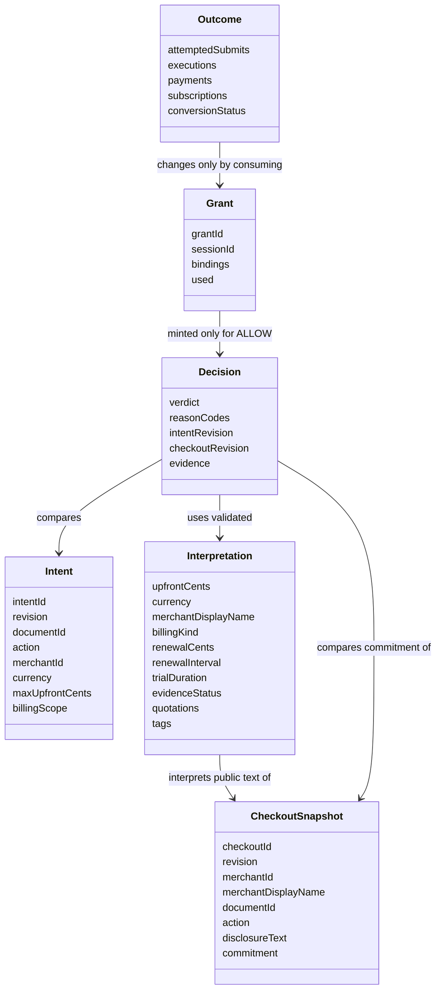
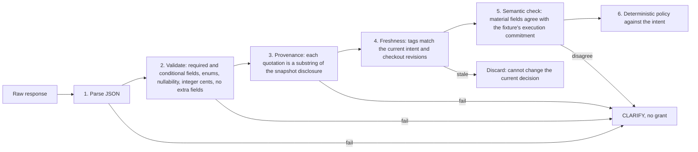

# 8. Crosscutting Concepts

<!-- arc42: Principal regulations and solution ideas relevant in multiple parts of the system. -->

<!-- arc42-generated -->
> **Status:** target architecture. These concepts are planned and nothing has been implemented, tested or measured. They apply only to the owned Paperlane Demo checkout ([docs/technical-decisions.md](../docs/technical-decisions.md)). Items marked *proposal* go beyond what the shared contract states.

## 8.1 Domain Model

| Entity | Contract (from [technical-decisions.md](../docs/technical-decisions.md)) |
|---|---|
| Intent | Line 34. Action `convert-one-document`, currency `USD`, cap in integer cents (default 200), billing scope `one_off_only`. Only explicit confirmation on Safety Belt's own surface creates or revises it. |
| Checkout snapshot | Line 35. Immutable per revision. `commitment` = upfront cents and currency, billing kind (`one_off`, `recurring`, `unknown`), renewal cents and interval, trial duration. Expected evaluation labels are stored separately and never included in model input. |
| Interpretation | Line 36. Evidence status: `clear`, `missing`, `contradictory`, `uncertain` or `unsupported`. Money is a nonnegative safe integer in cents. Quotations must be exact. |
| Decision | Line 37. `ALLOW`, `CONFLICT` or `CLARIFY` with stable reason codes and revisions. |
| Grant | Line 38. Opaque, single-use, server-held, bound to session, intent ID and revision, checkout ID and revision and all material commitment fields. |
| Outcome | Line 40. The source of truth for success. Attempts and executions are counted separately. |

The glossary for these terms is in [12-glossary.md](12-glossary.md).

## 8.2 Trust boundaries and the untrusted model output pipeline

| Boundary | What crosses it | Trust | Control |
|---|---|---|---|
| Browser → service | Intent confirmation, variant selection, check and submit requests | Untrusted input. The browser's own UI could be bypassed with direct JSON. | Host and Origin checks, JSON content type, body cap, route input validation. Grants and verdicts sent by the browser are ignored ([technical-decisions.md:41](../docs/technical-decisions.md), issue [#4](https://github.com/shinhf/safety-belt/issues/4)). |
| Fixture disclosure → model | Merchant name and disclosure text | Treated as untrusted merchant text, even though the fixture is owned | Sent as data with fixed instructions. The model has no tools, and instructions inside the disclosure cannot change intent or policy (issue [#3](https://github.com/shinhf/safety-belt/issues/3)). |
| Model → service | Structured JSON | Untrusted. Gemini does not guarantee semantically correct values and drops some schema keywords without warning (`safety-belt-mlh/planning/plugin-plan.md` §8.4). | The pipeline below |
| Service → browser | Decisions, quotations, merchant strings, counters | Contains untrusted strings | `textContent` only, strict CSP (§8.7) |

Model output goes through these steps in order. A failure at any step stops the flow, and the decision is `CLARIFY` with a reason:

Rules that hold at every step:

- The model's output is never turned into HTML, code or a request to another system ([technical-decisions.md:41](../docs/technical-decisions.md)).
- Recurrence must be shown by evidence, not inferred from what is missing. A one-off claim also needs a supporting quotation ([technical-decisions.md:36](../docs/technical-decisions.md)).
- Only the policy comparator's `ALLOW` reaches the grant service ([technical-decisions.md:37](../docs/technical-decisions.md)).

## 8.3 Approval binding and revision invalidation

- **Monotonic revisions.** The intent revision increments on every confirmed edit. The checkout revision increments on every change to a material field or the disclosure, including a change away and back ([technical-decisions.md:35](../docs/technical-decisions.md), issue [#1](https://github.com/shinhf/safety-belt/issues/1)).
- **Tag on request, compare on response.** The check flow records `(intentId, intentRevision, checkoutId, checkoutRevision)` before calling the model. A response whose tags differ from the current state is discarded and cannot restore a verdict or a grant ([technical-decisions.md:38](../docs/technical-decisions.md), issue [#4](https://github.com/shinhf/safety-belt/issues/4)).
- **Revoke on change and check at the gate.** Every intent change, snapshot change, reset or completed execution revokes outstanding grants. The gate still compares every bound field independently, so a revocation missed in one place cannot be exploited ([technical-decisions.md:38-39](../docs/technical-decisions.md)).
- **Reset ends the session.** *Proposal:* reset generates a new session ID. Grants bound to the old ID then fail the binding check even if one survived revocation.
- **No consent from review.** Reviewing subscription terms or clicking a warning action creates no approval, grant, payment or subscription. The MVP has no override that authorizes a subscription (issues [#2](https://github.com/shinhf/safety-belt/issues/2), [#6](https://github.com/shinhf/safety-belt/issues/6)).

## 8.4 Replay protection and the execution boundary

Following the OWASP Transaction Authorization guidance: each authorization credential is accepted once, bound to the transaction data, and checked server-side.

- Every submit path (button, Enter, direct JSON) calls the same handler. A disabled button alone is not enforcement (issue [#5](https://github.com/shinhf/safety-belt/issues/5)).
- Look up, compare, consume and record happen in one synchronous section with no `await`. In one Node process this serializes duplicate and concurrent submits without a lock or database ([technical-decisions.md:39](../docs/technical-decisions.md)).
- The gate executes the commitment captured in the grant, not mutable fixture state read again.
- A used, revoked, unknown, edited or pre-reset grant is rejected with zero side effects. At most one payment per intent and document, so a second grant cannot pay twice ([technical-decisions.md:40](../docs/technical-decisions.md)).
- If the client lost the response and retries, it gets a rejection for the used grant and reads the true outcome from the state route. *Proposal:* the UI shows the counters instead of retrying automatically.

## 8.5 Error handling: fail closed

| Condition | Result | Side effects |
|---|---|---|
| Missing or invalid intent | `CLARIFY` | None |
| Missing API key | Interpreter unavailable → `CLARIFY` | None |
| Provider timeout (10 s), HTTP error, rate limit | `CLARIFY`, sanitized reason | None |
| Malformed JSON, invalid shape, extra fields, quotation not in disclosure | `CLARIFY` | None |
| Evidence status `missing`, `contradictory`, `uncertain` or `unsupported`; unsupported money representation | `CLARIFY` | None |
| Interpretation disagrees with the fixture commitment | `CLARIFY` | None |
| Clear evidence of recurring billing, over cap (for example 201 cents), other currency, other merchant, action or document | `CONFLICT` with a specific reason | None |
| Stale model response | Discarded; the user must check again | None |
| Submit without a valid current grant | Rejected; attempt counted | Attempt counter only |

Sources: [technical-decisions.md:36-41](../docs/technical-decisions.md), issues [#3](https://github.com/shinhf/safety-belt/issues/3), [#4](https://github.com/shinhf/safety-belt/issues/4), [#5](https://github.com/shinhf/safety-belt/issues/5). Money is always compared in integer cents and never as floating-point. 200 cents is allowed and 201 cents is rejected (issue #4).
<!-- /arc42-generated -->

### Decision reason codes

Approved by the project owner on 2026-11-13. The policy comparator (issue [#4](https://github.com/shinhf/safety-belt/issues/4)) returns these codes with every `CONFLICT` or `CLARIFY` decision. They are stable identifiers: tests and the UI depend on the names.

| Decision | Code | Fires when |
|---|---|---|
| CONFLICT | `RECURRING_BILLING` | Validated terms show recurring billing; the intent is one-off only (the USD 1 trial that becomes USD 49.95 per month). |
| CONFLICT | `OVER_CAP` | Upfront integer cents exceed the cap (201 > 200). |
| CONFLICT | `CURRENCY_MISMATCH` | Currency is not USD. |
| CONFLICT | `MERCHANT_MISMATCH` | Merchant is not the approved one. |
| CONFLICT | `ACTION_MISMATCH` | Action is not `convert-one-document`. |
| CONFLICT | `DOCUMENT_MISMATCH` | Document is not the selected one. |
| CLARIFY | `INTENT_MISSING` | No valid confirmed intent. |
| CLARIFY | `MODEL_UNAVAILABLE` | Missing key, timeout, HTTP error or rate limit. |
| CLARIFY | `MODEL_OUTPUT_INVALID` | Malformed JSON, wrong shape, extra fields, or a quote that is not in the disclosure. |
| CLARIFY | `TERMS_MISSING` | Model reports the billing terms are absent. |
| CLARIFY | `TERMS_CONTRADICTORY` | Model reports contradictory terms. |
| CLARIFY | `TERMS_UNCERTAIN` | Model reports uncertain or unsupported terms. |
| CLARIFY | `UNSUPPORTED_AMOUNT` | The amount or currency representation cannot be compared as integer cents. |
| CLARIFY | `COMMITMENT_MISMATCH` | The interpretation disagrees with the commitment the checkout would execute. |

Not decision codes: a stale model response is discarded, not decided. Grant rejections at the execution gate (issue [#5](https://github.com/shinhf/safety-belt/issues/5)) use their own reasons, such as `GRANT_UNKNOWN`, `GRANT_USED`, `STATE_CHANGED` and `ALREADY_EXECUTED`.

<!-- arc42-manual: Decide the precedence when CONFLICT and CLARIFY codes fire together (proposal: return every code that fires; the decision is CONFLICT if any validated term conflicts, otherwise CLARIFY, otherwise ALLOW), and whether COMMITMENT_MISMATCH is checked in validation (issue #3) or in policy (issue #4). -->
<!-- /arc42-manual -->

<!-- arc42-generated -->
## 8.6 Privacy

- Only the public merchant display name and the exact snapshot disclosure text, plus the fixed instructions and schema, go to the fixed provider endpoint. The intent, hidden commitment fields, evaluation labels, document contents, and payment or personal fields never do ([technical-decisions.md:41](../docs/technical-decisions.md), issue [#3](https://github.com/shinhf/safety-belt/issues/3)).
- All documents, merchants, prices and payments are synthetic. There is no upload, card entry or live payment (issue [#1](https://github.com/shinhf/safety-belt/issues/1)).
- Keys and request bodies are never logged (§8.10).
- Issue [#7](https://github.com/shinhf/safety-belt/issues/7) checks this by inspecting the outgoing provider payload and the served assets and responses.

## 8.7 Web security of the local service

| Control | Concept | Source |
|---|---|---|
| Loopback bind | Listen on `127.0.0.1` only | [technical-decisions.md:32](../docs/technical-decisions.md) |
| Host check | Reject requests whose `Host` is not the expected loopback host and port (DNS-rebinding defence) | [technical-decisions.md:41](../docs/technical-decisions.md) |
| CSRF | Mutating routes require an `Origin` equal to the service origin and `Content-Type: application/json`. No permissive CORS headers. | technical-decisions.md:41; OWASP CSRF guidance |
| Body cap | The service enforces its own byte limit while reading the body, because core `http` has none. Oversize requests are rejected before parsing. | technical-decisions.md:41; plugin-plan.md §8.7 |
| Static allowlist | Serve named files only, so there is no path traversal and no `.env` | issue [#1](https://github.com/shinhf/safety-belt/issues/1) |
| Untrusted text | `textContent` for every disclosure, merchant and model string. *Proposal:* a strict Content-Security-Policy (`default-src 'self'`, no inline script) as defence in depth. | issue [#6](https://github.com/shinhf/safety-belt/issues/6) |
| Error sanitization | Responses and logs carry reason codes, not provider bodies or stack traces | [technical-decisions.md:41](../docs/technical-decisions.md) |

These controls protect one owned demo checkout. They do not authenticate third-party merchant backends or reveal undisclosed future charges ([technical-decisions.md:43](../docs/technical-decisions.md)).

## 8.8 Testing strategy

| Layer | Tool | What it proves | Model |
|---|---|---|---|
| Policy, validator, grants, gate | `node:test` | Price boundaries, recurrence, every scope mismatch, unknown evidence, stale-response rejection, single use (issue [#4](https://github.com/shinhf/safety-belt/issues/4)) | None; pure inputs |
| HTTP API | `node:test` against the real server on a local port | Outcome records and counts for allowed, missing, stale and replayed grants, including a term change just before submit. Host, Origin, content-type and body-cap rejections (issue [#5](https://github.com/shinhf/safety-belt/issues/5)) | Labelled replay fixtures |
| Browser journey | Playwright Test 1.65, Chromium; `webServer` with `url` and `baseURL` | Click and Enter after a change between check and submit, late response, duplicate submit, injected failures, no script execution from HTML-like evidence. Assertions use service state, not UI messages alone (issue [#7](https://github.com/shinhf/safety-belt/issues/7)) | Labelled replay fixtures |
| Live smoke check | Separate command, needs `GEMINI_API_KEY` | One synthetic call settles the API surface, request field name and API revision (issue [#3](https://github.com/shinhf/safety-belt/issues/3)) | Live |
| Live paraphrase set | Separate run, labels fixed before any model answer is seen | Raw counts of expected vs actual fields and class, failures and abstentions, with model and API revision recorded. No claim of broad accuracy (issue [#8](https://github.com/shinhf/safety-belt/issues/8)) | Live |

Rules:

- Deterministic tests need neither a key nor a network. Replay fixtures are labelled test doubles, and their passes are never reported as model accuracy (issue #7).
- Hydrogen ignores `temperature`, `topP` and `topK`, so live results can differ from run to run. Record each run and do not assume they are reproducible (plugin-plan.md §8.5).
- `node:test` coverage is experimental, so it is not a quality gate (plugin-plan.md §8.7).
- Pin the Playwright version with an npm lockfile (issue #7).

## 8.9 Configuration and secrets

| Variable | Purpose | Source |
|---|---|---|
| `GEMINI_API_KEY` | Provider key, used only by the service. When it is empty the interpreter is unavailable and the decision is `CLARIFY`. | [.env.example](../.env.example), issue [#3](https://github.com/shinhf/safety-belt/issues/3) |
| `GEMINI_MODEL` | `gemini-4-hydrogen`, pinned | [.env.example](../.env.example), [technical-decisions.md:17](../docs/technical-decisions.md) |

- Copy `.env.example` to `.env` and load it with `node --env-file=.env`. `.env` is listed in `.gitignore`, is never served and never appears in browser assets, responses or logs ([technical-decisions.md:41](../docs/technical-decisions.md)).
- The provider URL, host, timeout (10 s) and API revision are fixed in code, not set from the environment, so the provider endpoint cannot be redirected by configuration.
<!-- /arc42-generated -->

<!-- arc42-manual: Add the pinned API revision and any further variable once issue #3's smoke check settles them. -->
<!-- /arc42-manual -->

<!-- arc42-generated -->
## 8.10 Logging and observability

- The outcome counters (attempts, executions, payments, subscriptions, conversion status) are the observable truth. The UI reads them through a read-only route ([technical-decisions.md:40](../docs/technical-decisions.md)).
- Decisions show their evidence: the quoted disclosure text, reason codes, revisions, and whether the interpretation was live or replay (issues #3, #6).
- Logs record route, decision, reason code and revisions. They never record keys, request bodies or provider payloads ([technical-decisions.md:41](../docs/technical-decisions.md)).

## 8.11 User experience

- The intent confirmation is a separate Safety Belt surface. The approved scope stays visible while the user reviews the checkout (issue [#2](https://github.com/shinhf/safety-belt/issues/2)).
- The pause message names the actual mismatch without alleging fraud, for example "approved at most USD 2 once" against "USD 1 today then USD 49.95 each month after seven days". It offers Go back and Review subscription terms; review is read-only (issue [#6](https://github.com/shinhf/safety-belt/issues/6)).
- Pending or uncertain states never show a safe badge. The success screen is driven only by service state.
- The fixture is always labelled fictional, the payment and conversion simulated, and the interpretation live or replay. Native form submission, labels and focus work with the keyboard alone.
<!-- /arc42-generated -->

<!-- arc42-manual: Visual design and wording of the pause and success screens, if the demo needs more than the issue #6 criteria. -->
<!-- /arc42-manual -->
